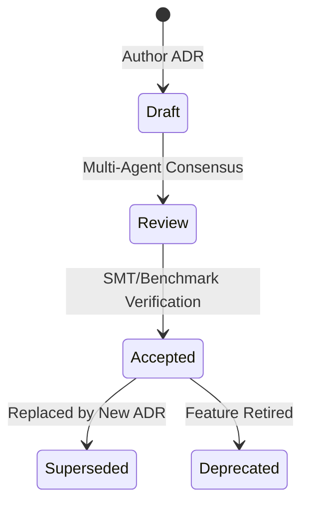

# Architecture Decision Records (ADRs)

This directory serves as the formal repository of **Architecture Decision Records (ADRs)** for the Kant programming language compiler toolchain (`kantc`). All records adhere to the **Markdown Architecture Decision Records (MADR)** specification (version 3.0.0).

---

## 1. Decision Matrix & Registry

The following table catalogs the 8 foundational P0 architectural decisions governing the core compiler invariants of Kant v0.1:

| ADR ID | Decision Title | Status | Date | Target Subsystem | Driver |
| :--- | :--- | :--- | :--- | :--- | :--- |
| [ADR-0001](file:///C:/Users/AdminOS/.gemini/antigravity/worktrees/1365faf8-e947-4948-a0c3-0ae0daefe8da/subagent-Documentation-Systems-Architect-sa-docs-systems-architect-fb74cb30/docs/adr/ADR-0001-de-bruijn-ast-canonicalization.md) | De Bruijn AST Canonicalization & Content Addressing | **Accepted** | 2026-11-06 | `kant-canonical` | Invariant $I_1$ (DefHash) |
| [ADR-0002](file:///C:/Users/AdminOS/.gemini/antigravity/worktrees/1365faf8-e947-4948-a0c3-0ae0daefe8da/subagent-Documentation-Systems-Architect-sa-docs-systems-architect-fb74cb30/docs/adr/ADR-0002-exact-effect-signature-matching.md) | Exact Algebraic Effect Matching ($E_{\text{decl}} = E_{\text{inf}}$) | **Accepted** | 2026-11-06 | `kant-effects` | Invariant $I_2$ (Sigil Law) |
| [ADR-0003](file:///C:/Users/AdminOS/.gemini/antigravity/worktrees/1365faf8-e947-4948-a0c3-0ae0daefe8da/subagent-Documentation-Systems-Architect-sa-docs-systems-architect-fb74cb30/docs/adr/ADR-0003-perceus-reference-counting-and-reuse.md) | Perceus Garbage-Free Reference Counting & In-Place Reuse | **Accepted** | 2026-11-06 | `kant-perceus` | Invariant $I_3$ (Zero GC) |
| [ADR-0004](file:///C:/Users/AdminOS/.gemini/antigravity/worktrees/1365faf8-e947-4948-a0c3-0ae0daefe8da/subagent-Documentation-Systems-Architect-sa-docs-systems-architect-fb74cb30/docs/adr/ADR-0004-noumena-capability-token-system.md) | Noumena Affine Capability Token Security System | **Accepted** | 2026-11-06 | `kant-noumena` | Invariant $I_4$ (`trust none`) |
| [ADR-0005](file:///C:/Users/AdminOS/.gemini/antigravity/worktrees/1365faf8-e947-4948-a0c3-0ae0daefe8da/subagent-Documentation-Systems-Architect-sa-docs-systems-architect-fb74cb30/docs/adr/ADR-0005-cranelift-native-backend-selection.md) | Cranelift Native Code Generator Selection over LLVM/GCC | **Accepted** | 2026-11-06 | `kant-codegen` | Fast JIT/AOT Cycles |
| [ADR-0006](file:///C:/Users/AdminOS/.gemini/antigravity/worktrees/1365faf8-e947-4948-a0c3-0ae0daefe8da/subagent-Documentation-Systems-Architect-sa-docs-systems-architect-fb74cb30/docs/adr/ADR-0006-dual-surface-sidecar-projection.md) | Dual-Surface ASCII Canonical Source & Arabic `.kantd` Sidecar | **Accepted** | 2026-11-06 | `kant-parser` | Tokenizer Efficiency |
| [ADR-0007](file:///C:/Users/AdminOS/.gemini/antigravity/worktrees/1365faf8-e947-4948-a0c3-0ae0daefe8da/subagent-Documentation-Systems-Architect-sa-docs-systems-architect-fb74cb30/docs/adr/ADR-0007-three-tier-contract-verification.md) | Three-Tier Contract Verification Pipeline (Vera Pattern) | **Accepted** | 2026-11-06 | `kant-antinomy` | Bounded SMT Solvability |
| [ADR-0008](file:///C:/Users/AdminOS/.gemini/antigravity/worktrees/1365faf8-e947-4948-a0c3-0ae0daefe8da/subagent-Documentation-Systems-Architect-sa-docs-systems-architect-fb74cb30/docs/adr/ADR-0008-rfc-6902-json-structured-diagnostics.md) | Structured JSON Diagnostics with RFC 6902 Auto-Fix Patches | **Accepted** | 2026-11-06 | `kant-diag` | Autonomous Agent Repair |

---

## 2. MADR Specification Structure

Every ADR in this directory adheres strictly to the following MADR schema:

1. **Title:** `# ADR-XXXX: <Decision Title>`
2. **Status:** `[Accepted | Superseded | Deprecated]`
3. **Context & Problem Statement:** Clear technical description of the compiler architectural challenge.
4. **Decision Drivers:** Constraints, invariants, agentic usability requirements, and performance criteria.
5. **Considered Options:** Minimum of three distinct technical alternatives evaluated.
6. **Decision Outcome:** Selected option, positive and negative consequences, and justification.
7. **Pros and Cons of the Options:** Rigorous trade-off breakdown for each evaluated candidate.
8. **Validation:** Concrete empirical verification method (e.g., test suite, differential fuzzing, SMT proof benchmark).

---

## 3. ADR Lifecycle & Governance

- **Draft:** Proposed architectural decision under evaluation.
- **Review:** Evaluated against compiler performance metrics and multi-agent invariants.
- **Accepted:** Ratified and binding on all compiler crates (`crates/kant-*`).
- **Superseded:** Formally replaced by a subsequent ADR.
