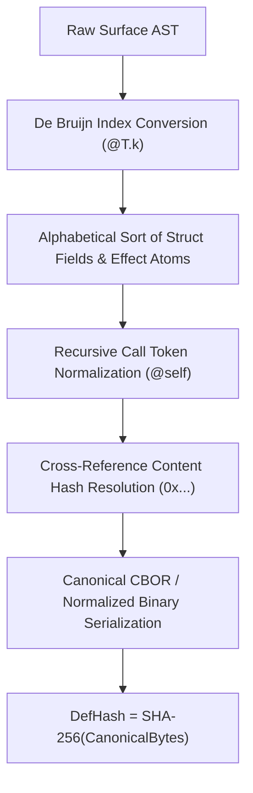
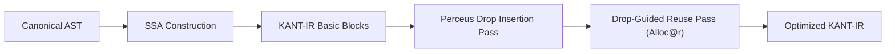

# 01. Compiler Pipeline & Intermediate Representations (`kantc`)

## 1. Executive System Overview

The Kant programming language compiler toolchain (`kantc`) is engineered from first principles as an epistemologically grounded, formally verified, AI-native compilation pipeline. Drawing upon the transcendental architecture of Immanuel Kant's *Critique of Pure Reason*—interpreted through the lens of modern constructive type theory, algebraic effect handlers, linear capability systems, and deterministic memory models—the compiler enforces strict invariants prior to execution.

The compiler operates under a zero-ambient-authority paradigm: source code is treated as an empirical intuition that must be canonicalized in space, typed under the 12 pure concepts of the understanding, checked for exact algebraic effects, lowered into a static single assignment (SSA) temporal schedule with drop-guided memory reuse, formally verified against contracts via satisfiability modulo theories (SMT), and compiled into native machine code via Cranelift.

```
+----------------------------------------------------------------------------------------------------+
|                                      THE KANT COMPILATION PIPELINE                                  |
+----------------------------------------------------------------------------------------------------+
                                                  │
                                                  ▼ [Stage 0: Ingestion]
                                 Source Text (.kant) with #![kant(v0.1)]
                                                  │
                                                  ▼ [Stage 1: Transcendental Aesthetic]
                                      kant-lexer (48-Token Lexicon)
                                                  │
                                                  ▼ Token Stream + Byte Spans
                                     kant-parser (Flattened Pratt / LL(1))
                                                  │
                                                  ▼ Surface AST (SurfaceAST)
                                  kant-canonical (Spatial Normalization)
                                                  │
                                                  ▼ Canonical AST (CanonicalAST) + SHA-256 DefHash
                                                  │
                        ┌─────────────────────────┴─────────────────────────┐
                        ▼ [Stage 2: Transcendental Analytic]                │
             kant-types (12-Categories Type Checker)                        │
                        │                                                   │
                        ▼ Checked AST with Categorical Signatures           │
             kant-effects (Exact Effect Inference & Quarantine)             │
                        │                                                   │
                        ▼ Verified Effect Annotations (E_decl == E_inf)     │
                        └─────────────────────────┬─────────────────────────┘
                                                  │
                                                  ▼ [Stage 3: The Schematism (Al-Shaym)]
                                      kant-ir (SSA IR Lowering Engine)
                                                  │
                                                  ▼ KANT-IR (30 Canonical SSA Instructions)
                                     kant-perceus (Drop & In-Place Reuse Pass)
                                                  │
                                                  ▼ Optimized KANT-IR with AllocReuse (@r)
                                                  │
                        ┌─────────────────────────┴─────────────────────────┐
                        ▼ [Stage 4: Transcendental Dialectic]               │
            kant-paralogism (Linear Ownership & Secret Taint Guard)         │
                        │                                                   │
            kant-antinomy (3-Tier Contract & Termination Verifier: Z3 SMT)  │
                        │                                                   │
            kant-noumena (Capability Sandbox & Governor Binding)            │
                        └─────────────────────────┬─────────────────────────┘
                                                  │
                                                  ▼ Verified Machine IR
                                    [Stage 5: Doctrine of Method]
                        ┌─────────────────────────┴─────────────────────────┐
                        ▼                                                   ▼
            kant-eval (Reference SSA VM)                         kant-codegen (Cranelift JIT/AOT)
                        │                                                   │
                        ▼                                                   ▼
         Merkle Evidence Trace (.evidence.jsonl)                  Native Executable (ELF/PE/Mach-O)
```

---

## 2. Phase-by-Phase Technical Decomposition

### 2.1. Stage 0 & 1: Transcendental Aesthetic (Ingestion, Lexing, Parsing, Canonicalization)

#### A. Source Header & Lexical Ingestion (`kant-lexer`)
The compiler accepts UTF-8 source files bearing the mandatory magic header `#![kant(v0.1)]` at byte offset 0. The lexer enforces a strictly closed vocabulary of 48 reserved tokens, prohibiting arbitrary user-defined syntactic extensions, unhygienic macros, or ambient operator overloading.

* **Token Structure:**
  ```rust
  pub struct Token {
      pub kind: TokenKind,
      pub span: TextSpan, // byte offset [start, end)
  }
  ```
* **Vocabulary Invariant:** Every token belongs to one of four closed sets: Toplevel Keywords (10), Effect & Governance Keywords (10), Control & Expression Keywords (10), Modality & Category Keywords (14), or Delimiters/Punctuation (14).
* **Deterministic Rejection:** Any character sequence outside ASCII identifiers, standard string literals, integers, floats, and the 48 closed tokens is rejected at $O(1)$ lookahead with diagnostic `KANT-E101`.

#### B. Flattened Pratt / LL(1) Parsing (`kant-parser`)
Kant enforces a flattened toplevel structure to maximize auto-regressive model KV-cache locality and eliminate contextual ambiguity. Deeply nested modules, inner classes, and closure captures over mutable lexical stacks are forbidden.

* **Grammar Class:** Deterministic $LL(1)$ for toplevel declarations (`afhoum`, `cap`, `fn`, `decision`) and Precedence Pratt parsing for expressions.
* **Typed Hole Production:** When the parser encounters `?hole` or `?hole: TypeExpr`, it instantiates an `Expr::Hole(HoleId, Option<TypeExpr>)`. This allows incremental compiler execution, type-directed synthesis queries, and automated program completion without syntax crashes.

#### C. Spatial Normalization & Content-Addressing (`kant-canonical`)
In Kant's transcendental aesthetic, **Space** is the invariant form of outer intuition. Code identity is independent of file paths, line numbering, comments, or human identifier labels.



The canonicalization transformation satisfies five formal rules:
1. **Rule C1 (De Bruijn Alpha-Conversion):** Parameter names are replaced with positional index tokens `@T.0`, `@T.1`, etc. Local `let` bindings are replaced with scope-depth De Bruijn slots `@T.k`.
2. **Rule C2 (Permutation Normalization):** Struct fields and declared effect sets are sorted in lexicographic ASCII order.
3. **Rule C3 (Content Pointers):** Calls to foreign definitions are rewritten from names to their 32-byte content hashes (`DefHash`).
4. **Rule C4 (Fixed-Point Self-Reference):** Recursive invocations are rewritten to `@self`.
5. **Rule C5 (DefHash Computation):** Comments and whitespace are stripped; the canonicalized tree is serialized into canonical deterministic binary format; the digest $\text{DefHash} = \text{SHA-256}(\text{Bytes})$ is minted.

Original human identifiers and localized Arabic terms are projected into the sidecar file `module.kantd`, preserving bi-directional readability without affecting the cryptographic identity of the code.

---

### 2.2. Stage 2: Transcendental Analytic (12-Categories Type System & Exact Effects)

#### A. Constructive Categorical Type Checking (`kant-types`)
Types are the pure concepts of the understanding (*Afahim*). The type checker implements a bidirectional type system (synthesis $\Gamma \vdash e \Rightarrow \tau$ and checking $\Gamma \vdash e \Leftarrow \tau$) grounded in Martin-Löf Constructive Type Theory:

$$\begin{array}{rcccl}
\text{Quantity} & : & \text{Unity (Atomic)} & \mid & \text{Plurality (Slices)} \mid \text{Totality (Exhaustive Sums)} \\
\text{Quality} & : & \text{Reality (Inhabited)} & \mid & \text{Negation (Never } ! \text{)} \mid \text{Limitation (Refinement)} \\
\text{Relation} & : & \text{Substance (Struct)} & \mid & \text{Causality (Effect Arrow)} \mid \text{Community (Stream)} \\
\text{Modality} & : & \text{Possibility (Option)} & \mid & \text{Actuality (Live Cap)} \mid \text{Necessity (Proof/Const)}
\end{array}$$

* **Bidirectional Unification:** Hindley-Milner type inference extended with structural subtyping for record field permutations and categorical modality checks.
* **Refinement Validation:** Refinement predicates `Refined<T, P>` are collected as verification conditions ($VC$) and emitted to the Antinomy contract solver queue.

#### B. Exact Effect Inference & Quarantine Analyzer (`kant-effects`)
Kant rejects effect subtyping (subsumption) in favor of the **Sigil Law**:

$$\forall f \in \text{Program}, \quad E_{\text{decl}}(f) = E_{\text{inf}}(f)$$

* **Static Effect Extraction:** The analyzer computes $E_{\text{inf}}(f)$ as the fixed-point union of all atomic effect emissions within the function body:
  $$E_{\text{inf}}(f) = \bigcup_{op \in body(f)} \text{EffectOf}(op)$$
* **Quarantined Dynamism:** Unbounded dynamic dispatch is strictly forbidden. Higher-order function invocations must use:
  1. Effect inheritance: `effects of(arg)`.
  2. Bounded dynamic dispatch: `dyn { target_1, ..., target_n }(fn_ptr, args)` where the callee's type is statically proved to belong to $\{target_1, \dots, target_n\}$. The inferred effect is the exact union:
     $$E_{\text{inf}}(\text{dyn } \{t_1, \dots, t_n\}) = \bigcup_{i=1}^n E_{\text{decl}}(t_i)$$
* **Automated Repair:** If $E_{\text{decl}} \neq E_{\text{inf}}$, the compiler halts with `KANT-E301` (undeclared escape) or `KANT-E302` (unused drift) and emits an RFC 6902 JSON patch with `FixSafety: SAFE`.

---

### 2.3. Stage 3: The Schematism (*Al-Shaym*) & Intermediate Representation

In Kantian epistemology, the Schematism bridges non-sensible categories with temporal intuition. In `kantc`, **Al-Shaym (`kant-ir`)** translates abstract types and effectful declarations into a discrete, time-directed Static Single Assignment (SSA) IR.



#### The 30 Canonical KANT-IR Instructions
Every instruction occupies a single temporal step in an SSA basic block:

| Class | Canonical Instructions | Operational Semantics |
| :--- | :--- | :--- |
| **Literals** | `ConstInt`, `ConstFloat`, `ConstBool`, `ConstString` | Load immediate constant value into SSA register. |
| **Composite** | `AllocStruct`, `AllocUnion`, `GetField`, `SetField` | Construct or access structural values. |
| **Arithmetic**| `Add`, `Sub`, `Mul`, `Div`, `Rem`, `Neg` | 2's complement 64-bit integer & IEEE 754 arithmetic. |
| **Logic** | `Eq`, `Ne`, `Lt`, `Le`, `Gt`, `Ge` | Boolean relational comparisons. |
| **Control** | `Jump`, `Branch`, `Return`, `Unreachable` | Basic block control flow transfers. |
| **Dispatch** | `CallDirect`, `CallDyn` | Pinned DefHash call or bounded quarantine dispatch. |
| **Memory** | `Dup`, `Drop`, `AllocReuse` | Perceus reference counting and buffer recycling. |
| **Effects** | `Perform`, `HandleWith`, `Resume` | Algebraic effect suspension, governor routing, resume. |

#### Perceus Reference Counting & Drop-Guided Reuse (`kant-perceus`)
1. **Structural Acyclicity:** Pointer cycles are prohibited at the type level. Cyclic graphs must use `ArenaIdx<T>`.
2. **Linear Drop Placement:** `Drop(v)` is inserted at the precise point of $v$'s last syntactic consumption.
3. **Drop Reuse Optimization:** When a heap-allocated cell $x$ is dropped immediately prior to an allocation of equivalent byte size $y = \text{Alloc}(T)$, Perceus rewires the operation:
   $$\text{Drop}(x) \ ; \ y = \text{Alloc}(T) \quad \Longrightarrow \quad y = \text{AllocReuse}(x, T)$$
   If $\text{RC}(x) == 1$, the underlying pointer is reused in-place without touching the memory allocator.

---

### 2.4. Stage 4: Transcendental Dialectic (Dialectical Guard, Verification & Noumena)

The Dialectic prevents pure reason from falling into antinomies (infinite non-terminating regress) and paralogisms (aliasing, capability duplication, and secret data leakage).

```
                 CONTRACT CLAUSE ANALYSIS
            requires P(x)  /  ensures Q(ret)
                          │
         ┌────────────────┴────────────────┐
         ▼                                 ▼
   Linear / Presburger              Non-linear / Inductive
         │                                 │
         ▼                                 ▼
 Tier 1A: Internal Simplifier      Tier 1B: Z3 SMT Solver (10s Budget)
         │                                 │
         ├─────────────────────────────────┤
         ▼ Proved                          ▼ Timeout / Unknown
┌─────────────────────────┐       ┌─────────────────────────┐
│ Zero-Overhead Static    │       │ Tier 3: Runtime Guard   │
│ Guarantee               │       │ (Compiled assert!)      │
└─────────────────────────┘       └─────────────────────────┘
```

#### A. The Paralogism Guard (`kant-paralogism`)
* **Linear Capability Check:** Capability tokens (`CapToken`) obey affine move semantics. Copying or reusing a consumed capability token triggers `KANT-E401`.
* **Secret Taint Tracking:** Values marked `Secret<T>` cannot be used in branch predicates (`if secret { ... }` -> `KANT-E405`) or memory address indices (`array[secret]` -> `KANT-E406`), eliminating timing and cache side channels. Memory is zeroized on drop.

#### B. The Antinomy Verifier (`kant-antinomy`)
* **Termination Proofs:** Every recursive function must define a well-founded metric in a `decreases` clause. The SMT solver verifies:
  $$\forall x, \quad x \to x' \implies 0 \le \text{decreases}(x') < \text{decreases}(x)$$
  Functions without termination proofs must explicitly declare the `diverge` effect.
* **3-Tier Verification:**
  - *Tier 1 (Static SMT):* Arithmetic bounds and invariants solved via built-in simplification or Z3 (10-second timeout).
  - *Tier 2 (Proof Hints):* Unsolved lemmas exported as typed diagnostics for AI agent hints.
  - *Tier 3 (Runtime Fallback):* Unresolved invariants compiled into runtime assertion contracts with audit flags.

#### C. The Noumena Boundary (`kant-noumena`)
The external world (files, network, hardware, LLMs) is the Noumenon (*Ding an sich*). The default execution state is `trust none`. External transitions require holding an explicit, unforgeable capability token governed by an active `handle ... with governor` runtime boundary.

---

### 2.5. Stage 5: Transcendental Doctrine of Method (Dual Codegen & Merkle Bundles)

The Doctrine of Method provides the execution discipline:

1. **Dual Execution Verification:**
   - **Reference Evaluator (`kant-eval`):** Safe Rust SSA interpreter. Evaluates KANT-IR directly, enforcing exact step limits and tracking memory invariants.
   - **Cranelift Backend (`kant-codegen`):** Translates KANT-IR to Cranelift IR (CLIF). Emits native machine code (x86-64, AArch64) with compile times $< 3 \text{ ms}$ per function.
   - **Conformance Oracle:** Both engines execute the standard 50-program test suite, enforcing bit-for-bit output and semantic equivalence:
     $$\text{Trace}(\text{Cranelift}(P)) \equiv \text{Trace}(\text{Evaluator}(P))$$
2. **Hash-Chained Merkle Evidence Bundles:**
   Execution traces, capability invocations, and approval decisions are written to `module.kant.evidence.jsonl`. Each entry includes `prev_block_hash`, `block_hash`, and capability receipts, allowing 100% deterministic offline replay via `kantc replay`.

---

## 3. Diagnostic Code Architecture

The compilation pipeline maps errors to deterministic, numbered fault codes:

| Error Code Range | Subsystem | Domain |
| :--- | :--- | :--- |
| `KANT-E101` – `KANT-E199` | `kant-lexer` | Lexical analysis, illegal glyphs, magic header violation. |
| `KANT-E201` – `KANT-E299` | `kant-parser` | Grammar syntax, invalid toplevel item, ill-formed hole. |
| `KANT-E301` – `KANT-E399` | `kant-effects` | Undeclared effect escape, unused effect drift, quarantine violation. |
| `KANT-E401` – `KANT-E499` | `kant-paralogism` | Capability use-after-move, secret taint branching, secret cache index. |
| `KANT-E501` – `KANT-E599` | `kant-antinomy` | Missing `decreases` clause, contract contradiction, SMT timeout. |
| `KANT-E601` – `KANT-E699` | `kant-canonical` | Lockfile drift (`module.kant.lock`), symbol hijack, hash mismatch. |
| `KANT-E701` – `KANT-E799` | `kant-noumena` | Ungoverned Noumena breach, missing capability token, sandbox abort. |

---

## 4. Pipeline Execution Invariants Summary

1. **Idempotent Invariance:** Re-running `kantc` on identical source text produces identical `DefHash` values, identical SSA basic blocks, and identical Cranelift binary bytes.
2. **Context Independence:** Each function definition is canonicalized and type-checked against its declared signature and explicit capability parameters without relying on ambient global state.
3. **Machine Repairability:** Every fatal diagnostic emitted between Stage 1 and Stage 3 includes an RFC 6902 JSON patch with an explicit `fix_safety` designation (`SAFE` vs `REVIEW`), empowering agentic orchestrators to repair compilation failures deterministically.
