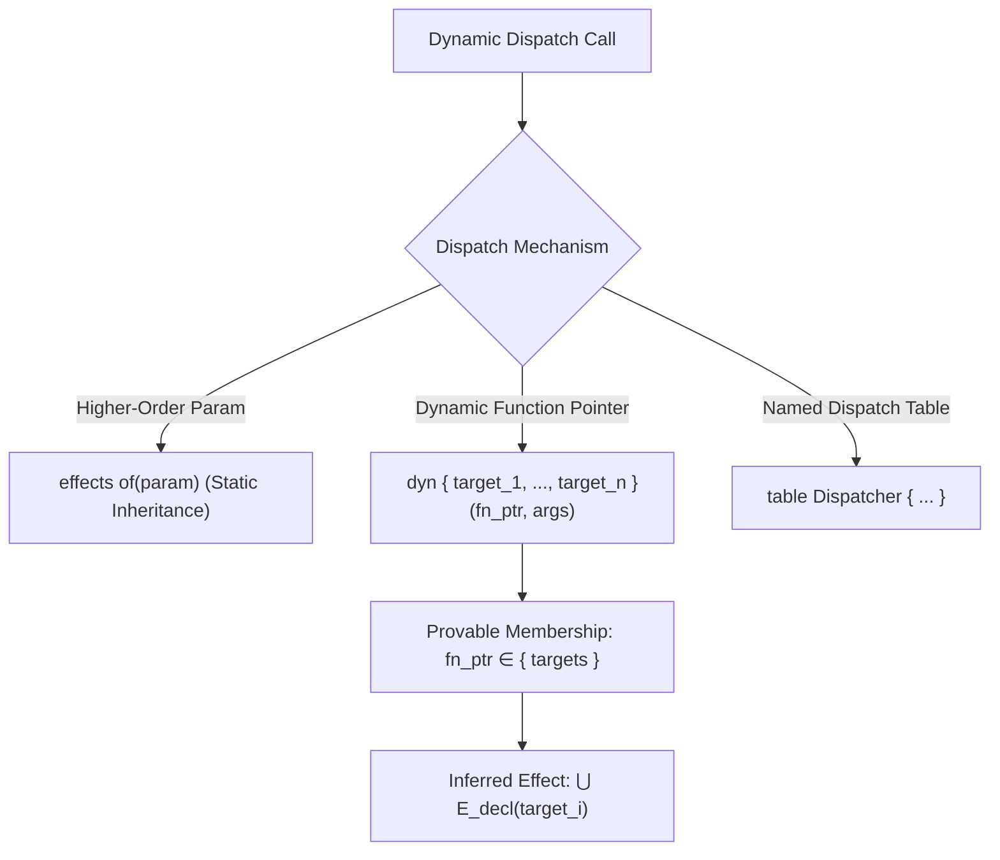

# 04. Algebraic Effect System & Quarantined Dynamism

## 1. Epistemological and Mathematical Foundations

Algebraic effect systems (Plotkin and Pretnar, 2009; Bauer and Pretnar, 2015) separate the **syntax of computational effects** (operations performed by a computation) from their **semantics** (handlers that interpret those operations). In traditional effect systems (Koka, Eff, Frank), effect inclusion is governed by subtyping (effect subsumption), allowing pure functions to silently widen their effect sets or allowing uncalled effects to linger in type signatures.

In the Kant compiler (`kantc`), algebraic effects represent the **Canon of Pure Reason** (*Kanon der reinen Vernunft*). Kant rejects ambient effect subtyping. Instead, the compiler enforces **Exact Effect Matching**—also designated the **Sigil Invariant** (empirical study arXiv:2607.27309)—alongside strict dynamic dispatch quarantine.

```
                    THE ALGEBRAIC EFFECT LIFECYCLE IN KANT
┌───────────────────────┐
│ Function Body e       │
│ performs op(x)        │
└───────────┬───────────┘
            │
            ▼ (Exact Inference Engine: kant-effects)
┌───────────────────────┐
│ Inferred Set E_inf    │  <─────── Strict Equality Check (E_decl == E_inf)
└───────────┬───────────┘           ├── Mismatch: Halt + Emit RFC 6902 JSON Patch
            │                       └── Match: Proceed to Lowering
            ▼
┌───────────────────────┐
│ Runtime Perform(op)   │
└───────────┬───────────┘
            │
            ▼ (Lowered via KANT-IR Schematism)
┌────────────────────────────────────────────────────────┐
│ Governor Boundary: handle { ... } with governor { ... } │
│ Captures Continuation k, executes handler arm, Resumes │
└────────────────────────────────────────────────────────┘
```

---

## 2. Exact Effect Matching (The Sigil Invariant)

### 2.1. The Exact Matching Law
Every function declaration $f$ must explicitly enumerate the exact set of atomic algebraic effects invoked within its transitive call graph:

$$\text{Function } f \text{ is well-typed} \iff E_{\text{decl}}(f) = E_{\text{inf}}(f)$$

Where:
- $E_{\text{decl}}(f)$ is the set of effects written in the `effects` contract clause of $f$.
- $E_{\text{inf}}(f)$ is the calculated transitive fixed-point union of all effectful operations in the body of $f$.

### 2.2. Failure Modes & Deterministic Auto-Fixes

When exact equality fails, the compiler halts and emits structured RFC 6902 JSON Patch diagnostics:

#### Mode 1: Undeclared Effect Escape (`KANT-E301`)
* **Trigger Condition:** $E_{\text{inf}}(f) \setminus E_{\text{decl}}(f) \neq \emptyset$.
* **Diagnostic Payload:**
  ```json
  {
    "code": "KANT-E301",
    "phase": "analytic.effects",
    "severity": "ERROR",
    "file": "src/network.kant",
    "message": "Undeclared effect escape: operation invokes 'net.http' which is not in declared effect set.",
    "got_effects": ["console.write", "net.http"],
    "want_effects": ["console.write"],
    "fix_safety": "SAFE",
    "quickfix_patch": [
      {
        "op": "replace",
        "path": "/functions/fetch_payload/effects",
        "value": ["console.write", "net.http"]
      }
    ]
  }
  ```

#### Mode 2: Unused Declared Effect Drift (`KANT-E302`)
* **Trigger Condition:** $E_{\text{decl}}(f) \setminus E_{\text{inf}}(f) \neq \emptyset$.
* **Diagnostic Payload:**
  ```json
  {
    "code": "KANT-E302",
    "phase": "analytic.effects",
    "severity": "ERROR",
    "file": "src/math.kant",
    "message": "Unused declared effect drift: 'fs.read' declared but never invoked.",
    "got_effects": ["pure"],
    "want_effects": ["fs.read"],
    "fix_safety": "SAFE",
    "quickfix_patch": [
      {
        "op": "replace",
        "path": "/functions/compute_hash/effects",
        "value": "pure"
      }
    ]
  }
  ```

---

## 3. The Core Effect Lattice

Effects form a bounded semi-lattice under set union ($\cup$), with `pure` as the identity element:

```
                            [All Noumena Effects]
                       /       |        |        \
                [fs.write] [net.http] [ai.infer] [clock.now]
                       \       |        |        /
                      [fs.read]      [console.write]
                             \        /
                            [console.read]
                                  |
                               [pure]
```

### The 8 Canonical Effect Atoms

| Effect Atom | Epistemic Description | Capability Required |
| :--- | :--- | :--- |
| `pure` | Mathematical computation with zero side-effects. | None |
| `console.read` | Reading interactive text input from standard input. | `ConsoleCap` |
| `console.write`| Writing text to standard output or standard error. | `ConsoleCap` |
| `fs.read` | Reading byte sequences from the local filesystem. | `FileReadCap` |
| `fs.write` | Mutating or creating files on the local filesystem. | `FileWriteCap` |
| `net.http` | Issuing TCP/TLS network calls and HTTP requests. | `NetCap` |
| `ai.infer` | Querying external Large Language Models or neural runtimes. | `AiCap` |
| `clock.now` | Accessing non-deterministic system wall-clock time. | `ClockCap` |
| `diverge` | Potential infinite loop or unproven recursive cycle. | None |

---

## 4. Quarantined Dynamism (Guarantees G1–G4)

Unconstrained function pointers, dynamic reflection, and unrestricted virtual method tables break the call graph. When an AI agent modifies a function, an incomplete call graph causes **blast radius blindness**, leading to silent regressions.

Kant solves this through **Quarantined Dynamism**:



### 4.1. The Four Quarantined Dynamism Guarantees

* **Guarantee G1 (Sound Blast Radius):** For any definition $D$, the exact set of affected call sites is computable in $O(|V| + |E|)$ time via `EffectCallGraph.reverse_callers(D)`.
* **Guarantee G2 (Complete Static Edges):** There are zero hidden execution paths. Every dynamic invocation must be statically bounded by an explicit target set.
* **Guarantee G3 (Bounded Dynamic Dispatch):** Dynamic calls are restricted exclusively to:
  1. *Effect Parameter Inheritance:* `effects of(callback)`
  2. *Quarantine Blocks:* `dyn { fn_a, fn_b, fn_c }(callee, args)`
  3. *Closed Dispatch Tables:* `table Router { "get" => handle_get, "post" => handle_post }`
* **Guarantee G4 (Effect Union Determinism):** The inferred effect of a quarantined dynamic invocation is the exact union of all declared targets:
  $$E_{\text{inf}}(\text{dyn } \{t_1, \dots, t_n\}) = \bigcup_{i=1}^{n} E_{\text{decl}}(t_i)$$

---

## 5. Handlers, Continuations & The Governor Runtime

Algebraic effects are executed using the `handle ... with governor` construct:

```kant
pub fn execute_workflow(req: Request) -> Response
{
    effects pure
} = {
    handle {
        let data = read_config("app.toml");
        process(data)
    } with governor {
        fs.read(path) -> {
            resume(mock_file_content(path))
        }
    }
}
```

### 5.1. Lowering Semantics in KANT-IR
1. **`Perform(effect_id, args)`:** Suspends the current SSA execution frame and passes control to the nearest enclosing `HandleWith` block matching `effect_id`.
2. **Continuation Reification:** The runtime captures the call stack segment between the `Perform` site and the `HandleWith` boundary into a linear continuation value `k`.
3. **`Resume(k, val)`:** Resumes execution of the suspended continuation with `val` as the result of the `perform` expression, consuming `k`.
4. **Sandboxed Governor:** In production environments, the governor inspects capability tokens, logs Merkle audit evidence, and invokes `approval_gate` before allowing external transitions.
