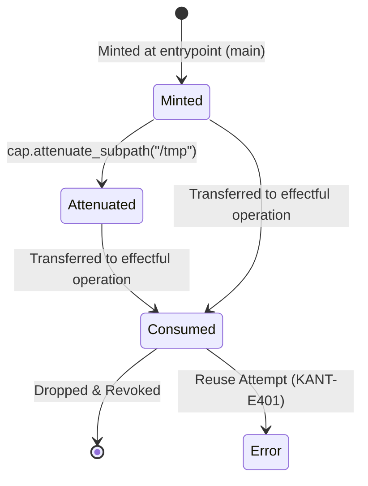

# 05. The Noumena Capability Security Model & Runtime Governor

## 1. Epistemological Architecture: Phenomena vs. Noumena

In the *Critique of Pure Reason*, Immanuel Kant establishes a fundamental epistemological divide:
- **Phenomena (الظاهرات / الفينمانات):** Objects of sensible intuition that are structured by the a priori forms of Space and Time and organized by the Categories of Understanding. In the Kant programming language toolchain (`kantc`), Phenomena represent all in-memory, deterministic, verified computational structures.
- **Noumena / Things-in-themselves (النومان / الأشياء في ذواتها):** The intelligible realm lying beyond the horizon of pure sensibility. We can think them, but we cannot know or directly manipulate them through pure understanding. In `kantc`, the Noumenon is the **Untrusted External World**:
  - The Operating System kernel and system calls.
  - The local filesystem and hardware clocks.
  - Sockets, network infrastructure, and web endpoints.
  - External non-deterministic Large Language Models (LLMs) and foundation model APIs.

```
+────────────────────────────────────────────────────────────────────────────+
│                         PHENOMENA (TRUSTED MEMORY)                         │
│                                                                            │
│    Canonical AST    •    12 Categories Typing    •    KANT-IR SSA          │
│    Perceus RC       •    SMT Verified Contracts  •    Pure Logic           │
+──────────────────────────────────────┬─────────────────────────────────────+
                                       │
                      THE NOUMENA ZERO-ESCAPE BOUNDARY
                      (Enforced Default: trust none)
                                       │
                                       ▼
+────────────────────────────────────────────────────────────────────────────+
│                         THE NOUMENA RUNTIME GOVERNOR                       │
│                                                                            │
│    1. Linear Capability Tokens (Affine Move-Only Tokens)                   │
│    2. Attenuation Gateways (e.g., restrict to /tmp or single domain)       │
│    3. Interactive Human Approval Gates (approval_gate(policy))             │
│    4. Append-Only Merkle Evidence Logging (.evidence.jsonl)                │
+──────────────────────────────────────┬─────────────────────────────────────+
                                       │
                                       ▼
+────────────────────────────────────────────────────────────────────────────+
│                        NOUMENA (EXTERNAL REALITY)                          │
│                                                                            │
│     Filesystem     •     Network Sockets     •     External LLM APIs       │
+────────────────────────────────────────────────────────────────────────────+
```

---

## 2. The Zero-Escape Boundary (`trust none`)

By default, every `.kant` compilation unit operates under the **Zero-Escape Boundary**:
1. **Zero Ambient Authority:** Functions cannot import global handles, access ambient file descriptors, read environment variables, or construct network sockets out of thin air.
2. **Deterministic Sandboxing:** Pure code cannot determine whether it is running on a bare-metal CPU, a test runner, or an SSA virtual machine simulator. Non-determinism (entropy, clocks, IO) requires passing an explicit, linear capability.
3. **No Unsafe Escape Hatch:** Unlike C (`void*`) or Rust (`unsafe`), Kant has no `unsafe` keyword in the language. Boundary breaches trigger fatal compiler error `KANT-E701` (Ungoverned Noumena Breach).

---

## 3. Linear / Affine Capability Tokens

To interact with the Noumenon, a program must hold an explicit **Capability Token** (`CapToken`). Capabilities obey strict affine ownership rules:

```kant
cap FsCap {
    read(path: String) -> [Int64];
    write(path: String, bytes: [Int64]) -> Unit;
}

cap NetCap {
    connect(host: String, port: Int64) -> SocketId;
}

cap ClockCap {
    now_utc() -> Int64;
}
```

### 3.1. Capability Lifecycle Semantics



1. **Unforgeable Genesis:** Capability tokens cannot be constructed by user expressions. They are minted exclusively by the runtime environment and injected into the root entrypoint:
   ```kant
   pub fn main(fs: cap &FsCap, net: cap &NetCap) -> Int64
   {
       effects fs.read, net.http
   } = { ... }
   ```
2. **Move-Only Affine Semantics:** Capabilities cannot be cloned (`dup` is forbidden on `CapToken`). Passing a capability to a consuming function transfers ownership.
3. **Use-After-Move Detection (`KANT-E401`):** Attempting to invoke an operation on a capability that has already been moved results in a static verification failure in `kant-paralogism`.
4. **Attenuation:** Capabilities can be attenuated (restricted to a narrower privilege domain) via pure projection, but can never be widened:
   ```kant
   let scoped_fs = fs.attenuate_readonly("/tmp/sandbox");
   ```

---

## 4. The Session-Governor-Executor Pattern & Human Approval Gates

When an agentic system executes high-impact operations (mutating production configurations, transferring funds, executing shell processes), programmatic capabilities are coupled with **Human Approval Gates**:

```kant
pub fn deploy_service(net: cap &NetCap, config: String) -> Response
{
    effects net.http
} = {
    handle {
        net.post("https://api.prod.cluster/deploy", config)
    } with governor {
        net.http(url, payload) -> {
            // Suspends execution and requests cryptographic sign-off
            let approved = approval_gate(Policy::HighRiskProductionDeploy);
            if approved {
                resume(execute_raw_post(url, payload))
            } else {
                resume(Response::Denied)
            }
        }
    }
}
```

### 4.1. The `approval_gate` Protocol
1. When execution reaches an `approval_gate`, the SSA evaluator or native runtime suspends the continuation.
2. A cryptographic request payload is written to the terminal and emitted via the Model Context Protocol (`kant-mcp`).
3. The human operator or authorization engine signs the request with an Ed25519 private key.
4. The runtime validates the signature, attaches the approval block to `module.kant.evidence.jsonl`, and resumes the computation.

---

## 5. Secret Taint Analysis & Side-Channel Elimination

The Paralogism Guard (`kant-paralogism`) enforces strict information-flow control for cryptographic keys, tokens, and credentials via the `Secret<T>` wrapper type:

```kant
afhoum AuthToken {
    key: Secret<String>,
}
```

### 5.1. The Three Secret Taint Invariants

* **Invariant T1 (No Secret-Dependent Branches):**
  A secret value cannot be used as the condition in an `if` expression or `match` statement:
  ```kant
  if secret_key == candidate { ... } // REJECTED: KANT-E405 (Secret Branch Leak)
  ```
  Equality must use constant-time comparison primitives: `constant_time_eq(secret_key, candidate)`.

* **Invariant T2 (No Secret-Dependent Memory Access):**
  A secret value cannot be used as an array index or table lookup offset:
  ```kant
  let byte = sbox[secret_byte]; // REJECTED: KANT-E406 (Secret Cache Side-Channel)
  ```
  Prevents CPU cache-line timing attacks (e.g. Spectre, Bernstein AES cache attacks).

* **Invariant T3 (Zeroize-on-Drop):**
  When an SSA variable containing `Secret<T>` reaches the end of its live range, the Perceus destructor executes a volatile zero-fill instruction (`volatile_memset(ptr, 0, size)`) before returning the memory to the heap.

---

## 6. Summary of Noumena Security Invariants

1. **Total Isolation:** Pure code has provably zero means of interacting with the host system without an explicit capability token.
2. **Auditability:** Every Noumena crossing is recorded with cryptographic SHA-256 hashes in an append-only Merkle evidence log.
3. **Provable Non-Interference:** High-security secrets cannot influence low-security observable execution traces or branch timings.
