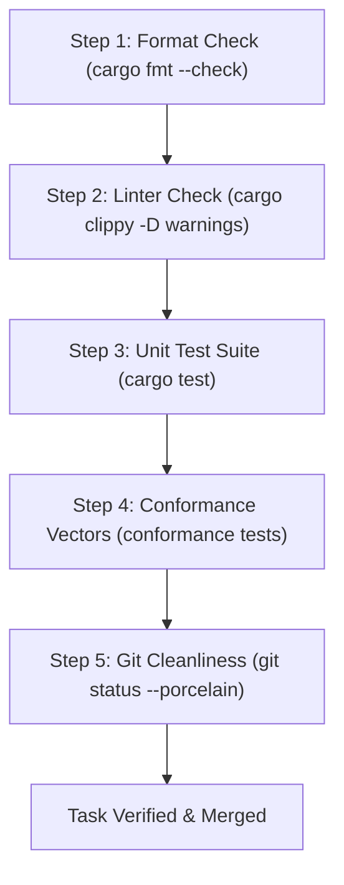

# The Five-Step Verification Harness Manual

## 1. The Iron Law of Verification

Empirical software engineering research in autonomous multi-agent environments (e.g. SIGIL study, arXiv:2607.27309) demonstrates that in conversational programming interfaces, agents declare tasks "complete" without executing verification in over 44% of instances.

To eradicate unverified completions, the Kant project constitution establishes **THE IRON LAW OF VERIFICATION**:

> **No sub-agent may declare a task complete, and no pull request or worktree may be merged into `main`, without executing the mandatory Five-Step Verification Harness and attaching raw terminal outputs directly into their verification report.**

---

## 2. The Five-Step Verification Execution Sequence

Every agent must execute the following five steps in sequence within their assigned workspace lane:



### Step 1: Automated Format Verification
Verifies that all Rust code adheres to the canonical formatting style:
```bash
cargo fmt -p <crate-name> -- --check
```
*Failure Action:* Run `cargo fmt -p <crate-name>` to automatically apply formatting. Re-run check.

### Step 2: Strict Linter & Warning Elimination
Enforces zero clippy warnings across all compilation targets (library, binaries, tests):
```bash
cargo clippy -p <crate-name> --all-targets -- -D warnings
```
*Failure Action:* Inspect emitted clippy lints. Refactor code to resolve all warnings. No `#![allow(...)]` overrides are permitted without architectural sign-off.

### Step 3: Unit and Integration Test Suite
Executes all unit and integration test assertions with full output:
```bash
cargo test -p <crate-name> -- --nocapture
```
*Failure Action:* Diagnose test failures using stack traces. All unit assertions must pass with 0 failures and 0 panics.

### Step 4: Mandatory Conformance Test Vectors
Runs the cross-backend conformance suite, verifying differential consistency between the Reference Evaluator and Cranelift codegen:
```bash
cargo test -p <crate-name> conformance -- --exact
```
*Failure Action:* Ensure memory mutation traces and terminal outputs match byte-for-byte.

### Step 5: Git Status & Lane Cleanliness Verification
Verifies that no untracked artifacts, temporary files, debug binaries, or out-of-lane modifications remain in the working tree:
```bash
git status --porcelain <crate-path>
```
*Success Condition:* Command outputs zero lines (working tree clean).

---

## 3. Workspace-Wide Verification Command

For workspace-wide verification (conducted prior to release merges):

```bash
# Execute workspace verification harness
cargo fmt --all -- --check
cargo clippy --workspace --all-targets -- -D warnings
cargo test --workspace
git status --porcelain
```

---

## 4. Troubleshooting Common Failures

| Failure Mode | Root Cause | Remediation |
| :--- | :--- | :--- |
| **`cargo fmt` diff detected** | Inconsistent line breaks or indentation | Run `cargo fmt --all` |
| **`clippy::needless_borrow`** | Redundant `&` reference | Remove superfluous borrow |
| **`clippy::too_many_arguments`** | Function signature exceeds 7 arguments | Group into an `afhoum` parameter struct |
| **Out-of-lane git status** | File created outside assigned crate lane | Remove or relocate file to assigned directory |
| **SMT Timeout in Tier 1** | Complex non-linear arithmetic in contract | Lower contract to Tier 3 runtime check or add proof lemma |

---

## 5. Attaching Verification Evidence to Reports

When authoring a milestone completion report (in `docs/reports/`):
1. Copy raw terminal output blocks from all five verification steps.
2. Embed the blocks in fenced code blocks under Section: `Verification Evidence`.
3. Provide the final commit SHA and branch name.
