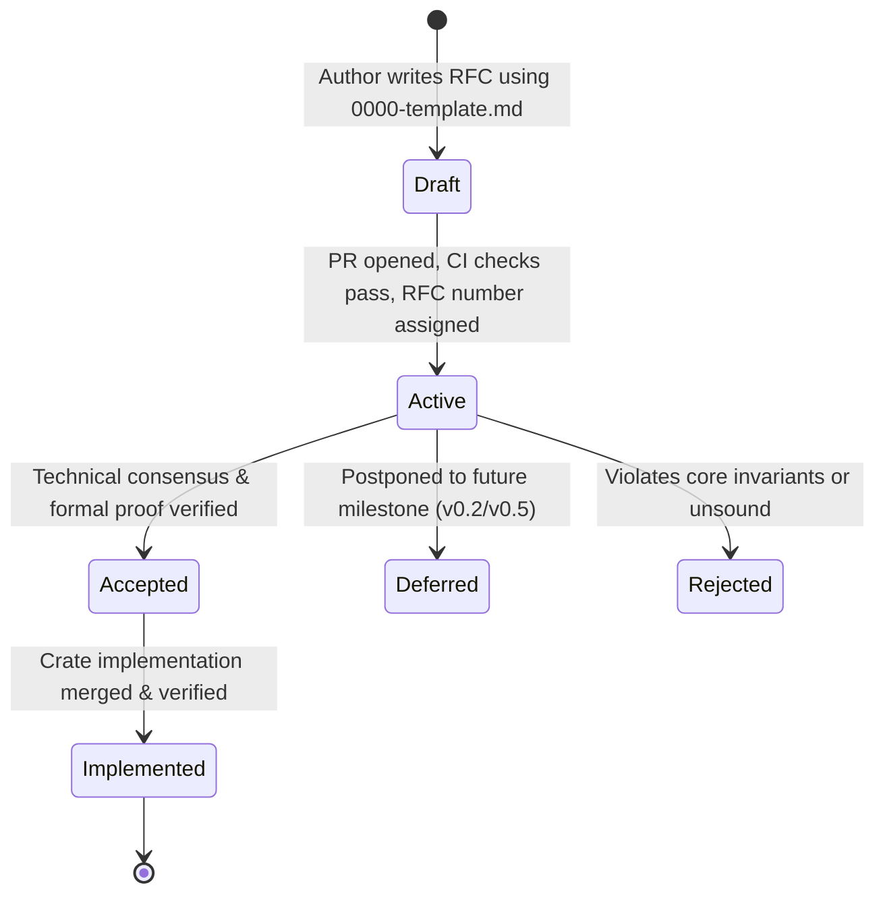

# Kant Request for Comments (RFC) Framework

## 1. Purpose and Philosophy

The **Request for Comments (RFC)** process provides a disciplined, rigorous, and consensus-driven mechanism for evolving the Kant programming language toolchain (`kantc`). Major changes—such as new syntax constructs, adjustments to the 12-categories type theory, new primitive algebraic effects, memory allocator modifications, or tooling protocol revisions—must pass through the RFC process before implementation commences.

This process ensures that all proposed changes are vetted for:
1. **Mathematical Soundness:** Preserving constructive type theoretic invariants.
2. **Epistemic Integrity:** Aligning with Kantian epistemology and the Moussa Wehbe philosophical framework.
3. **Agent Friendliness:** Minimizing LLM token overhead and maximizing auto-regressive predictability.
4. **Zero-Ambient Authority:** Upholding the Noumena security boundary.

---

## 2. RFC Lifecycle & State Transition Model



### 2.1. Lifecycle States

1. **Draft:** The proposal is being formulated. It resides in a feature branch or draft PR.
2. **Active:** The proposal is assigned a sequential 4-digit number (e.g. `0001-atomic-stream-channels.md`), opened for public and multi-agent review.
3. **Accepted:** The RFC has reached consensus, satisfied all governance gates, and is approved for implementation in an upcoming milestone.
4. **Implemented:** The code changes described by the RFC have been fully implemented, verified via the Five-Step Verification Harness, and merged into `main`.
5. **Deferred:** The RFC is architecturally sound but postponed to a subsequent release wave (e.g., v0.2 or v0.5) in accordance with `docs/DECISIONS_AND_DEFERRED_ROADMAP.md`.
6. **Rejected:** The RFC has been declined due to invariant violations, unacceptable performance overhead, or lack of consensus.

---

## 3. Governance Criteria & Approval Gates

To transition an RFC from **Active** to **Accepted**, the proposal must clear three mandatory approval gates:

### Gate 1: Invariant Preservation Check
The RFC must demonstrate that it does not violate any of the four fundamental compiler invariants:
- **$I_1$ (Deterministic Content-Addressing):** AST canonicalization and `DefHash` stability are preserved.
- **$I_2$ (Exact Effect Matching):** $E_{\text{decl}}(f) = E_{\text{inf}}(f)$ remains strictly enforced.
- **$I_3$ (Garbage-Free Memory Management):** Memory remains deterministic under Perceus; no unbounded cycles or tracing GC introduced.
- **$I_4$ (Noumena Zero-Escape Boundary):** Default remains `trust none`; no ambient authority or unmediated IO.

### Gate 2: Machine Repairability & QuickFix Contract
If the proposal introduces new compiler errors or syntax rules, it must define the corresponding structured JSON diagnostic payload and an RFC 6902 JSON patch with designated `FixSafety` (`SAFE` vs `REVIEW`).

### Gate 3: Verification Evidence & Benchmarks
The proposal must include an empirical verification plan:
- SMT/Z3 formal proof schema or test vectors.
- Performance impact assessment (compilation speed, runtime memory footprint, binary size).

---

## 4. RFC Directory Conventions

All RFCs are stored in this directory (`docs/rfcs/`) using the filename pattern:
```
docs/rfcs/XXXX-descriptive-title.md
```
Where:
- `XXXX` is a zero-padded 4-digit sequential integer (e.g. `0001`, `0002`).
- `descriptive-title` is a lowercase, kebab-case summary.

To propose a new RFC, copy [`0000-template.md`](file:///C:/Users/AdminOS/.gemini/antigravity/worktrees/1365faf8-e947-4948-a0c3-0ae0daefe8da/subagent-Documentation-Systems-Architect-sa-docs-systems-architect-fb74cb30/docs/rfcs/0000-template.md) and populate all required sections.
